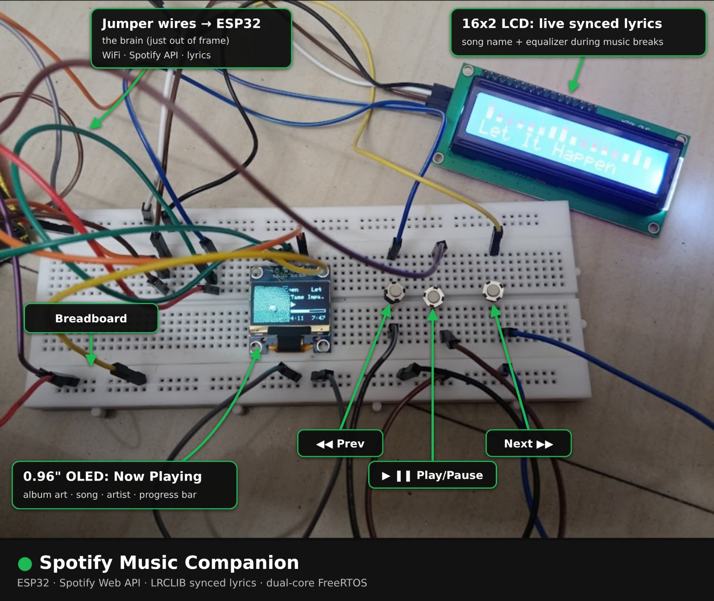
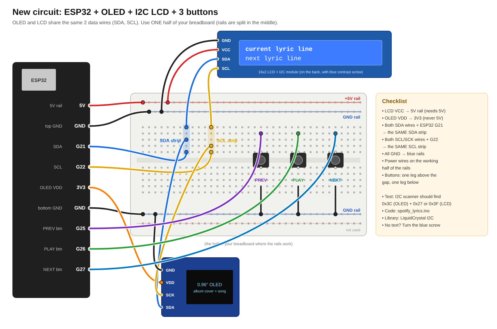

# 🎵 Spotify Music Companion | ESP32 + OLED + LCD + Live Synced Lyrics

A smart desk gadget built using **ESP32, OLED and LCD displays** that brings Spotify playback information to your desk.

It displays album artwork, song information, playback controls and live synced lyrics that appear in time with the music.



> 🎥 **Demo Video:** [Add your LinkedIn / YouTube video link here]

---

## ✨ Features

| Component | Function |
|---|---|
| **0.96" OLED (SSD1306)** | Displays album artwork, song title, artist, playback status and progress bar |
| **16×2 I2C LCD** | Displays synced lyrics with a typewriter effect |
| **Equalizer Animation** | Displays an animation during instrumental sections |
| **3 Physical Buttons** | Previous, Play/Pause and Next controls |
| **ESP32** | Handles Wi-Fi, Spotify API communication and display control |

### 🎮 Physical Controls

| Button | Function |
|---|---|
| ◀◀ Previous | Plays the previous track |
| ▶❚❚ Play / Pause | Toggles playback |
| Next ▶▶ | Skips to the next track |

### 🎤 LCD Lyrics Features

- Live synced lyrics using LRCLIB.
- Letter-by-letter karaoke-style text animation.
- Equalizer animation during instrumental sections.
- 3-2-1 countdown before vocals return.
- Adjustable lyric timing offset.

---

## ⚙️ How It Works

The project connects the ESP32 to Spotify using Wi-Fi and the Spotify Web API.

1. **Spotify Web API:** Reads the currently playing track and controls playback using OAuth 2.0.
2. **LRCLIB API:** Retrieves time-synced lyrics in LRC format.
3. **OLED Display:** Shows album artwork, song information and playback progress.
4. **LCD Display:** Shows lyrics synchronized with the song.
5. **Physical Buttons:** Control previous, play/pause and next playback actions.
6. **FreeRTOS:** Uses a separate task for LCD updates to keep lyric animation responsive.

### Album Artwork Processing

- Downloads album artwork as JPEG.
- Decodes the image using TJpg_Decoder.
- Converts it into a black-and-white image using Floyd–Steinberg dithering.
- Displays the result on the 1-bit OLED screen.

### I2C Communication

The OLED and LCD share the same I2C bus, allowing both displays to communicate with the ESP32 using the same SDA and SCL connections.

---

## 📂 Project Structure

The project was developed in stages. Each folder represents an improvement over the previous version.

```text
Spotify-Music-Companion/
│
├── only OLED_display/
│   └── Song information and progress bar
│
├── oled+coverart/
│   └── OLED album artwork display
│
├── spotify_buttons_control/
│   └── Physical playback controls
│
├── spotify_control_oled_Lcd_lyrics/
│   └── Complete project with synced lyrics
│
├── Collab_run_code
│   └── Google Colab script for Spotify token setup
│
├── images/
│   ├── setup.jpg
│   └── wiring.png
│
└── README.md
```

⭐ **Recommended:** Open `spotify_control_oled_Lcd_lyrics/` for the complete project.

---

## 🛠️ Components Required

| Component | Quantity |
|---|---:|
| ESP32 Dev Module (ESP32-WROOM) | 1 |
| 0.96" OLED SSD1306 (128×64, I2C) | 1 |
| 16×2 LCD with I2C backpack (PCF8574) | 1 |
| Push buttons | 3 |
| Breadboard | 1 |
| Jumper wires | As required |
| USB cable | 1 |
| Spotify Premium account | 1 |

---

## 🔌 Wiring



### OLED and LCD — Shared I2C Connections

| Connection | ESP32 |
|---|---|
| OLED VDD | 3V3 |
| LCD VCC | 5V (VIN) |
| OLED GND / LCD GND | GND |
| OLED SCL / LCD SCL | GPIO 22 |
| OLED SDA / LCD SDA | GPIO 21 |

### Button Connections

Each button uses an ESP32 GPIO and GND, with internal pull-up resistors enabled.

| Button | ESP32 GPIO |
|---|---|
| Previous | GPIO 25 |
| Play / Pause | GPIO 26 |
| Next | GPIO 27 |

**Note:** Confirm the voltage compatibility of your LCD I2C backpack and OLED before connecting them to the ESP32.

---

## 💻 Software Setup

### 1. Arduino IDE

Install the ESP32 board package through:

`Boards Manager → esp32 by Espressif Systems`

Select:

`ESP32 Dev Module`

If uploading fails, try setting the upload speed to 115200.

### 2. Required Libraries

Install these libraries using Arduino IDE Library Manager:

- Adafruit SSD1306
- Adafruit GFX Library
- ArduinoJson (v7)
- TJpg_Decoder
- LiquidCrystal I2C (Frank de Brabander)

### 3. Create a Spotify Developer App

1. Visit the [Spotify Developer Dashboard](https://developer.spotify.com/dashboard).
2. Create a new application.
3. Add the redirect URI:

```text
http://127.0.0.1:8888/callback
```

4. Enable the Web API.
5. Copy your Client ID and Client Secret.

### 4. Get Your Spotify Refresh Token

The project uses OAuth 2.0 to obtain a refresh token for Spotify API access.

Required permissions include:

```text
user-read-currently-playing
user-read-playback-state
user-modify-playback-state
```

The `user-modify-playback-state` permission is required for playback button controls.

Use the `Collab_run_code` Google Colab script to complete the token setup.

[Open Google Colab](https://colab.research.google.com/)

### 5. Configure the ESP32

Open:

```text
spotify_control_oled_Lcd_lyrics/Control_Oled_LCD.ino
```

Configure the following values locally:

```cpp
const char* WIFI_SSID     = "YOUR_WIFI";
const char* WIFI_PASSWORD = "YOUR_PASSWORD";
const char* CLIENT_ID     = "YOUR_CLIENT_ID";
const char* CLIENT_SECRET = "YOUR_CLIENT_SECRET";
const char* REFRESH_TOKEN = "YOUR_REFRESH_TOKEN";
```

Upload the code to the ESP32, connect it to Wi-Fi and start Spotify playback on an active device.

**Security:** Never upload your real Wi-Fi password, Spotify Client Secret or refresh token to GitHub.

---

## ⚙️ Customisable Settings

| Setting | Default | Description |
|---|---:|---|
| `LYRIC_OFFSET_MS` | `1200` | Adjusts lyric synchronization |
| `LCD_STYLE` | `1` | `1` = Karaoke style, `0` = Classic lyrics |
| `LCD_ADDRESS` | `0` | `0` = Auto-detect, or manually set `0x27` / `0x3F` |
| `I2C_CLOCK` | `400000` | I2C communication speed; lower to `100000` if needed |

---

## 🧯 Troubleshooting

| Problem | Possible Solution |
|---|---|
| OLED blank | Check SDA, SCL and display connections |
| LCD shows boxes | Adjust the contrast potentiometer on the I2C backpack |
| Spotify asks for a new token | Check token validity and required permissions |
| Open Spotify message | Start playback on an active Spotify device |
| No lyrics found | LRCLIB may not have synced lyrics for that track |
| Random LCD characters | Try reducing I2C clock speed to 100000 |
| Upload error | Close Serial Monitor and try a lower upload speed |

---

## 📚 What I Learned

- ESP32 programming and Wi-Fi communication.
- Spotify Web API integration.
- OAuth 2.0 authentication and refresh tokens.
- REST API communication and JSON parsing.
- I2C communication with multiple displays.
- JPEG decoding and Floyd–Steinberg dithering.
- FreeRTOS tasks, synchronization and dual-core programming.
- Physical button controls and hardware debugging.
- Time-synchronized lyrics and display animations.

---

## 🙏 Credits

- [Spotify Web API](https://developer.spotify.com/documentation/web-api)
- [LRCLIB — Synced Lyrics API](https://lrclib.net/)
- [Adafruit Libraries](https://github.com/adafruit)
- [TJpg_Decoder](https://github.com/Bodmer/TJpg_Decoder)

---

## 👨‍💻 Author

**Prithvi Mishra**

- GitHub: [Prithvimishra7](https://github.com/Prithvimishra7)
- LinkedIn: [Prithvi Mishra](https://www.linkedin.com/in/prithvi-mishra-63337036b)

⭐ If you find this project interesting, consider giving the repository a star!
